<div align="center">


<a href="https://aristided.vercel.app">
  
</a>

[](https://aristided.vercel.app)
[](https://www.linkedin.com/in/aristidedongo)
[](https://x.com/AristideCode)
[](mailto:dongokouamearistide95@gmail.com)
[](https://discord.gg/raven_dev_ghost)
[](https://www.npmjs.com/~aristidedongo)

</div>

---

## About me

I'm a **full-stack developer based in Abidjan 🇨🇮**, available for remote work. I design and ship web products from end to end — scoping, interface, API, data and production deployment.

Beyond product work, I publish **open source developer tools on npm**: a production-grade SMPP stack, a context bridge between AI coding agents, and a typed logger. I care about type safety, tests, secure defaults and docs people actually want to read.

```ts
const aristide = {
  location:  "Abidjan, Côte d'Ivoire · remote-friendly",
  languages: ["French", "English"],
  frontend:  ["React", "Next.js", "TypeScript", "Tailwind CSS", "Vite"],
  backend:   ["Node.js", "NestJS", "Express", "REST", "Zod"],
  data:      ["PostgreSQL", "Prisma", "MongoDB", "Redis", "Supabase", "SQLite"],
  mobile:    ["Flutter", "Dart"],
  devops:    ["Docker", "GitHub Actions", "Vercel", "Railway", "AWS"],
  focus:     "Reliable backends, protocol work & developer tooling",
  offline:   ["Manga", "Cartoons", "Video games"],
};
```

---

##  Open source packages

<table>
<tr>
<td width="50%" valign="top">

### 📡 [smpp-ts](https://github.com/AristideDongo/smpp-ts)
[](https://www.npmjs.com/package/smpp-ts)
[](https://www.npmjs.com/package/smpp-ts)


**SMPP v3.4 / v5.0 client & server** for Node.js, Bun and Deno. Secure by default (verified TLS), reconnection with re-bind, send window, rate limiting, long SMS splitting, delivery receipts. Parser fuzz-tested on 1M inputs.

`TypeScript` `Telecom` `SMS` `TLS`

```sh
npm i smpp-ts
```

</td>
<td width="50%" valign="top">

###  [ThreadPort](https://github.com/AristideDongo/threadport)
[](https://www.npmjs.com/package/threadport)
[](https://marketplace.visualstudio.com/items?itemName=aristideghost.threadport-vscode)

**One context. Any AI agent.** A CLI + VS Code extension that carries dev context (decisions, tasks, notes, tests, Git snapshots) between Claude Code, Codex and other agents. Local SQLite storage, MCP integration.

`TypeScript` `CLI` `MCP` `AI tooling`

```sh
npm i -g threadport
```

</td>
</tr>
<tr>
<td width="50%" valign="top">

###  [GlyphLog](https://github.com/AristideDongo/glyphLog)
[](https://www.npmjs.com/package/glyphlog)
[](https://www.npmjs.com/package/glyphlog)

**Fully typed logging library** for TypeScript/JavaScript: multiple transports (Console, File, HTTP, Memory), formatters, middleware, child loggers, built-in profiling. Works in Node.js and the browser.

`TypeScript` `Logging` `Node.js` `Browser`

```sh
npm i glyphlog
```

</td>
<td width="50%" valign="top">

###  [OpenTask](https://github.com/AristideDongo/opentask)


**Free, self-hostable team work management**: workspaces, roles, projects, tasks, Kanban and real-time discussion. Full-stack monorepo — NestJS API, React + Vite UI, PostgreSQL/Prisma, Docker Compose, Playwright E2E.

`NestJS` `React` `PostgreSQL` `Docker` `Turborepo`

```sh
docker compose up -d
```

</td>
</tr>
</table>

---

##  Tech stack

<div align="center">

**Frontend**<br/>


**Backend & data**<br/>


**Mobile, DevOps & tools**<br/>


</div>

---

##  GitHub metrics

<div align="center">


</div>

---

##  Contribution graph

<picture>
  <source media="(prefers-color-scheme: dark)" srcset="https://raw.githubusercontent.com/AristideDongo/AristideDongo/output/pacman-contribution-graph-dark.svg">
  <source media="(prefers-color-scheme: light)" srcset="https://raw.githubusercontent.com/AristideDongo/AristideDongo/output/pacman-contribution-graph.svg">
  
</picture>

---

<div align="center">

###  Let's work together

Open to **full-stack / backend roles**, freelance missions and open source collaborations.<br/>
The fastest way to reach me is by [email](mailto:dongokouamearistide95@gmail.com) or on [LinkedIn](https://www.linkedin.com/in/aristidedongo).


</div>
